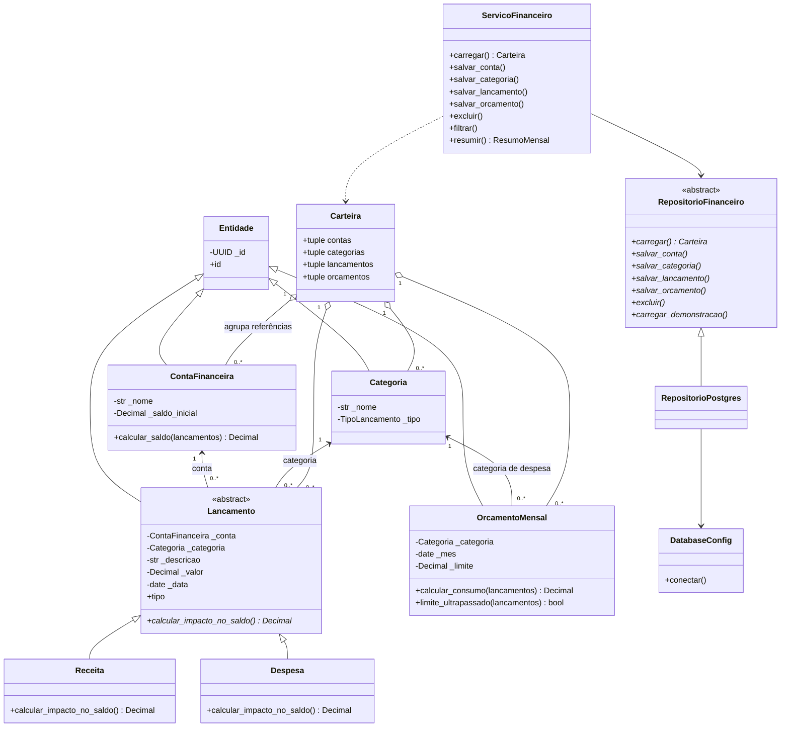

# Modelagem e decisões

## Fluxo de colaboração

1. O formulário converte texto monetário em Decimal e chama um serviço.
2. O serviço busca referências e constrói objetos válidos.
3. O repositório grava em uma transação PostgreSQL.
4. A próxima execução lê uma fotografia consistente do banco e reconstrói objetos.
5. O domínio calcula saldos e orçamentos; a interface apenas os apresenta.

O Streamlit reexecuta scripts, mas uma gravação só acontece na submissão de um
formulário ou na carga explicitamente acionada. `st.session_state` guarda apenas
navegação/feedback/revisão dos formulários; não armazena a carteira persistente.

## Por que herança aqui?

Receita e Despesa compartilham identidade, data, conta, categoria e valor, mas têm
impactos opostos. O método abstrato expressa essa diferença comportamental. A escolha
do construtor na entrada e na leitura do banco é uma fábrica simples; o cálculo
percorre objetos já construídos e usa despacho polimórfico.

## Encapsulamento em Python

Atributos usam `_` por convenção e propriedades sem setters. Construtores validam
invariantes. Python não oferece privacidade absoluta: acessar deliberadamente um
atributo interno pode contornar a convenção, por isso o restante do sistema utiliza
apenas a interface pública. Edições são novos objetos validados com o mesmo UUID.

## Associação, agregação e composição

`Lancamento` mantém referências a `ContaFinanceira` e `Categoria`: associação.
`Carteira` agrupa referências em tuplas para representar uma fotografia dos dados:
agregação. As entidades permanecem no banco mesmo quando essa fotografia é descartada.
O diagrama usa losangos vazios para esse agrupamento.

O projeto não modela uma composição UML forte com posse exclusiva e ciclo de vida
dependente entre essas entidades. A expressão "composição das dependências" em
`bootstrap.py` descreve a montagem de objetos colaboradores e tem outro sentido.

## Banco e concorrência

Não há coluna de saldo corrente: o saldo é derivado. Chaves estrangeiras compostas
garantem compatibilidade entre categoria e tipo, inclusive em gravações concorrentes.
A unicidade categoria/mês permite upsert atômico de orçamentos. A carga inicial usa
uma transação e bloqueia escritas durante a verificação de banco vazio.

O repositório abre e fecha conexões por operação; não compartilha uma conexão global
entre threads. Edições simultâneas de um registro seguem última gravação válida.
Versionamento otimista pode ser uma evolução futura, fora do escopo inicial.
